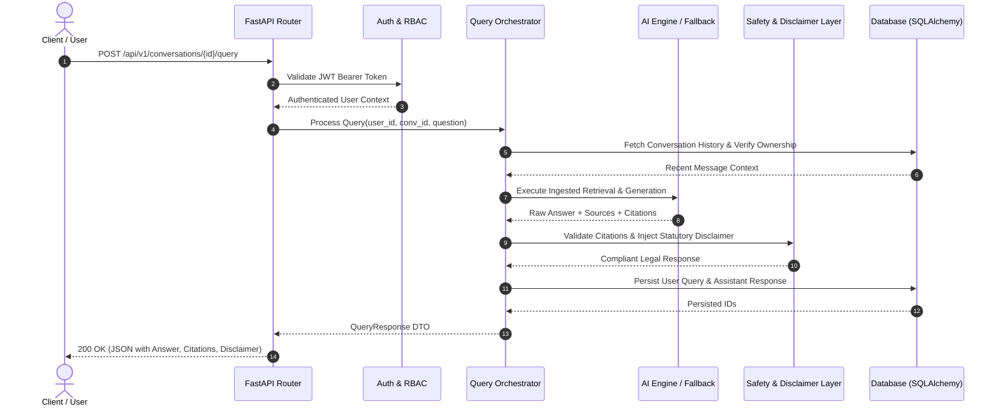

# SPECTRE — System Architecture & Backend Integration Guide

## 1. Executive Summary

**SPECTRE** (AI-Based Legal Assistant, e-Lawyer and Case Guidance System) is an intelligent legal information platform tailored to the Indian legal jurisdiction. This document outlines the architectural blueprints, component interactions, API orchestration flow, and integration boundaries designed by **Member 1 (Backend & Integration / Technical Owner)** in accordance with the Software Requirements Specification (SRS v1.0).

---

## 2. High-Level System Architecture

```
+-----------------------------------------------------------------------------------+
|                                  USER / CLIENT LAYER                              |
|   Web Browser (React/Next.js UI) / Mobile Client / REST Clients                   |
+-----------------------------------------------------------------------------------+
                                          |
                                          | HTTPS / REST (JSON)
                                          v
+-----------------------------------------------------------------------------------+
|                        API GATEWAY & CORS / SECURITY LAYER                        |
|   FastAPI Middleware (CORS, Rate Limiting, Request Validation, JWT Auth)         |
+-----------------------------------------------------------------------------------+
                                          |
          +-------------------------------+-------------------------------+
          |                               |                               |
          v                               v                               v
+--------------------+         +--------------------+         +--------------------+
| AUTH & USER MGMT   |         | CORE ORCHESTRATOR  |         | KNOWLEDGE SERVICES |
| - Registration     |         | - Query Validation |         | - Legal Procedures |
| - Login / JWT      |         | - Context Pipeline |         | - Legal Templates  |
| - RBAC (User/Admin)|         | - Safety Injection |         | - Case References  |
| - Audit Logging    |         | - Conversation Hist|         | - Admin Content    |
+--------------------+         +--------------------+         +--------------------+
          |                               |                               |
          |                               v                               |
          |                    +--------------------+                     |
          |                    |  AI/RAG ADAPTER    |                     |
          |                    | - SpectreService   |                     |
          |                    | - Domain Classifier|                     |
          |                    | - Citation Check   |                     |
          |                    | - Fallback Engine  |                     |
          |                    +--------------------+                     |
          |                               |                               |
          +-------------------------------+-------------------------------+
                                          |
                                          v
+-----------------------------------------------------------------------------------+
|                             DATA PERSISTENCE LAYER                                |
|   SQLAlchemy 2.0 ORM  <--->  SQLite (Dev) / PostgreSQL (Production)             |
|   - Users & Roles            - Legal References     - Document Templates          |
|   - Conversations            - Messages & Citations - Audit Logs                  |
+-----------------------------------------------------------------------------------+
```

---

## 3. Subsystem Breakdown

### 3.1 Backend Orchestration (`backend/app`)
- **FastAPI Core**: High-performance asynchronous REST framework.
- **Dependency Injection**: Centralized database sessions (`get_db`), authentication tokens (`get_current_user`), and role guards (`require_admin`).
- **Safety Layer**: Pre- and post-processing pipelines ensuring generated content never guarantees outcomes and always attaches statutory legal disclaimers.

### 3.2 AI & RAG Integration Subsystem (`backend/app/services/ai_client.py`)
- Interfaces with the SPECTRE AI engine contract (`AI_CONTRACT.md`).
- Operates in dual-mode:
  1. **Direct In-Process Engine**: Invokes `SpectreService` for vector retrieval and LLM generation.
  2. **Resilient Local Fallback**: When LLM keys or OCR dependencies are unavailable, the system safely falls back to authoritative rule-based categorization and statutory guidance without downtime (NFR-QUAL-02).

### 3.3 Database & Persistence Subsystem (`backend/app/models`, `backend/alembic`)
- SQLAlchemy ORM with declarative models.
- Full migration support through Alembic.
- Strict data isolation ensuring users cannot access or tamper with foreign conversations (NFR-SEC-04).

---

## 4. Query Orchestration Sequence



---

## 5. Security & Compliance Safeguards (SRS Section 5.8 & 6.3)

1. **Mandatory Disclaimer**: Applied globally. Neither users nor administrative overrides can omit the disclaimer (REQ-SAFE-06).
2. **No Outcome Guarantees**: Any uncertain legal generation is scrubbed of definitive outcome assurances (REQ-SAFE-03).
3. **Emergency Escalation**: Detection of urgent distress or abuse automatically attaches national helpline numbers (112, 1091, 1930, 1098).
4. **Data Isolation**: All conversation and message queries enforce `user_id == current_user.id`.
